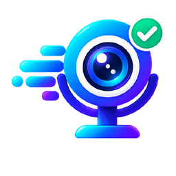
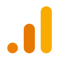
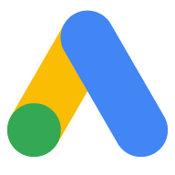
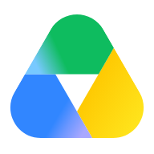
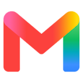
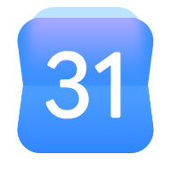

<div align="center">



# CamMicGo SEO MCP

**Your Google data, your LinkedIn profile and five scientific sources, inside your AI assistant.**

Free · Open source (MIT) · Remote MCP for Claude, ChatGPT and other clients · Local MCP for Windows, macOS and Linux

[](./LICENSE)
[](https://modelcontextprotocol.io/)
[](https://nextjs.org/)
[](https://seo.cammicgo.com)

**[Website](https://seo.cammicgo.com)** · **[Connect your assistant](https://seo.cammicgo.com/mcp/connect)** · **[Your account](https://seo.cammicgo.com/account)** · **[Privacy](https://seo.cammicgo.com/privacy)** · **[CamMicGo](https://www.cammicgo.com)**

&nbsp;
&nbsp;
&nbsp;
&nbsp;
&nbsp;
&nbsp;
&nbsp;
&nbsp;
&nbsp;
&nbsp;
&nbsp;
&nbsp;


</div>

---

## What it is

CamMicGo SEO MCP is a [Model Context Protocol](https://modelcontextprotocol.io/) server. It lets your AI assistant work with **your own accounts**: Search Console, Google Analytics 4, YouTube and YouTube Analytics, Google Ads, Drive, Gmail, Calendar, LinkedIn publishing, and five scientific sources. Ask in plain language, for example *"Which queries lost clicks this month?"*, *"Where do my YouTube viewers come from?"* or *"Post this on my LinkedIn"*, and the assistant calls the right tool.

- **Read-only by default.** Write permissions are optional boxes that you tick yourself.
- **Nothing is published, spent or trashed without your explicit yes.** The assistant always shows the exact preview first.
- **Your own credentials.** Google calls use your own Google Cloud project, and LinkedIn uses your own LinkedIn app. Secrets are encrypted on the server and never shown to the assistant.
- The website and every guide are available in **11 languages**: English, French, Spanish, German, Portuguese, Italian, Russian, Chinese, Japanese, Korean and Arabic.

## Services

| | Service | What your assistant can do | Where |
|:-:|---|---|---|
|  | **Search Console** | Queries, pages, countries and devices for web, image, video, news, Discover and Google News, with regex filters and up to 25,000 rows. It can also show what changed between two periods, inspect URLs (index status, canonical, last crawl) and check sitemaps. | Remote + local |
|  | **Google Analytics 4** | Any dimensions and metrics, with filters, sorting and comparison with the previous period, plus realtime active users | Remote + local |
|  | **YouTube Data API** | Search, channels, videos, playlists and comments. Timestamped transcripts come through the CamMicGo apps. *Optional, remote only:* **upload a video to your channel** after your yes. | Remote + local |
|  | **YouTube Analytics** | Your channels: views, watch time, subscribers, top videos, traffic sources, the YouTube search terms that brought viewers, countries, devices, age and gender, and retention curves | Remote |
|  | **LinkedIn** | **Posts on your own profile**: text with an image, a video or a link, through your own LinkedIn app | Remote |
|  | **Google Ads** | Accounts and performance reports. Campaigns are created **paused**, with a fixed total budget, after your confirmation. | Remote |
|  | **Google Drive** | List, search and read Docs, Sheets, Slides, PDF and text files. *Optional:* create folders and files, and move to the trash after your yes (never permanent deletion). | Remote |
|  | **Gmail** | Search and read your emails, read-only | Remote |
|  | **Google Calendar** | Calendars and events, read-only | Remote + local |
|  | **OpenAlex** | Open catalog of works, authors, institutions and citations; a researcher's complete list with BibTeX, RIS, CSV and Markdown exports | Remote + local |
|  | **Semantic Scholar** | AI-powered academic search, citations and references | Remote + local |
|  | **arXiv** | Preprints in physics, mathematics, computer science, statistics and more, with open full text | Remote + local |
|  | **PubMed** | Biomedical and life-science literature, with abstracts and links to free full text | Remote + local |
|  | **HAL** | French open archive: articles, theses and preprints, often with full text | Remote + local |

**Other Google services:**
- Docs, Sheets and Slides are readable through the Drive tools.
- Tasks, Contacts, Classroom, Chat and Apps Script are available as OAuth permissions only, with no dedicated tools yet.

## Get started: step-by-step guides

Every setup has a complete illustrated guide on the website.

| You want to… | Guide |
|---|---|
| Connect Claude, ChatGPT or another remote MCP client | **[Connect your assistant](https://seo.cammicgo.com/mcp/connect)** |
| Create your own Google Cloud project (OAuth client, APIs to enable) | **[Google Cloud setup](https://seo.cammicgo.com/setup/google-cloud)** |
| Run the MCP on your own computer | **[Windows](https://seo.cammicgo.com/setup/local/windows)** · **[macOS](https://seo.cammicgo.com/setup/local/macos)** · **[Linux](https://seo.cammicgo.com/setup/local/linux)** |
| Get YouTube transcripts with the remote MCP | **[Android app](https://seo.cammicgo.com/download/android)** · **[Desktop relay](https://seo.cammicgo.com/download/desktop)** |
| Publish on your LinkedIn profile | **[LinkedIn setup](https://seo.cammicgo.com/setup/linkedin)** |
| Raise the scientific sources' limits with free keys | **[Scientific sources](https://seo.cammicgo.com/setup/science)** |

### Remote MCP in four steps

1. In your assistant, add the custom connector `https://seo.cammicgo.com/api/mcp` (Streamable HTTP with OAuth).
2. Sign in to CamMicGo with your email and authorize the assistant.
3. On [your account](https://seo.cammicgo.com/account), save your Google Cloud OAuth client: **Web application**, with the redirect URI `https://seo.cammicgo.com/api/auth/google/callback`. Tick the APIs you want, then click **Connect Google**.
4. Ask: *"List my Search Console sites and my GA4 properties."*

YouTube blocks cloud servers, so the remote MCP fetches transcripts through a device you pair: the [Android app](https://seo.cammicgo.com/download/android) or the [desktop relay](https://seo.cammicgo.com/download/desktop) for Windows, macOS and Linux. Ask your assistant for a pairing code. The local MCP doesn't need a paired device.

### Local MCP in short

Requires Node.js 22+ and Git.

```bash
git clone https://github.com/CamMicGo/cammicgo-seo-agent.git
cd cammicgo-seo-agent
npm install
npm run install:local   # guided: Google Desktop OAuth client, sign-in, agent registration
npm run local:doctor    # checks credentials and tokens
```

- **OAuth client:** the local MCP uses a **Desktop app** OAuth client from your own Google Cloud project. Tokens stay encrypted on your computer.
- **Register it in your assistant:** `npm run agent:setup -- claude` (or `gemini`, `cursor`) adds the stdio server to Claude Desktop, Gemini CLI or Cursor.
- **More help:** full guide on the [website](https://seo.cammicgo.com/setup/local), with troubleshooting in [docs/LOCAL-MCP-INSTALL.md](docs/LOCAL-MCP-INSTALL.md).

## Tools

### Remote MCP: `https://seo.cammicgo.com/api/mcp`

| Area | Tools |
|---|---|
| Account | `service_info`, `list_google_properties` |
| Search Console | `search_console_report`, `search_console_changes`, `search_console_inspect_url`, `search_console_sitemaps` |
| Google Analytics 4 | `ga4_report`, `ga4_realtime` |
| YouTube | `youtube_search_videos`, `youtube_video_details`, `youtube_channel`, `youtube_find_channels`, `youtube_video_comments`, `youtube_upload_video` ✎ |
| YouTube Analytics | `youtube_channel_stats`, `youtube_top_videos`, `youtube_audience`, `youtube_video_retention` |
| Transcripts (paired device) | `youtube_get_transcript`, `youtube_channel_batch`, `youtube_batch_status`, `youtube_transcript_status`, `device_pairing_code`, `device_revoke` |
| LinkedIn | `linkedin_post` ✎ |
| Google Ads | `ads_accounts`, `ads_report`, `ads_create_paused_campaign` ✎ |
| Google Drive | `drive_list_files`, `drive_search_files`, `drive_read_file`, `drive_storage_quota`, `drive_create_folder` ✎, `drive_upload_file` ✎, `drive_trash_file` ✎, `drive_restore_file` ✎ |
| Gmail | `gmail_search`, `gmail_read` |
| Google Calendar | `calendar_list`, `calendar_events` |
| Scientific sources | `science_search`, `science_latest`, `science_paper`, `science_author`, `science_author_works`, `science_citations`, `science_fulltext`, `science_verify_references`, `science_sources` |
| Google API catalog | `search_apis`, `describe_operation`, `read_operation`: read-only operations of Calendar, YouTube, YouTube Analytics, Search Console and Gmail |

✎ marks a tool that writes something. These tools always work in two steps: an exact preview first, then your explicit yes.

### Local MCP (stdio, read-only)

The local server has 23 tools:
- **Account and properties:** `service_info`, `find_google_properties`
- **Search Console:** `list_search_sites`, `search_performance`, `seo_keyword_opportunities`
- **Google Analytics 4:** `list_ga4_properties`, `ga4_top_pages`, `ga4_countries`
- **YouTube:** `youtube_my_channels`, `youtube_my_videos`, `youtube_video_metrics`, `youtube_get_transcript` (the local server fetches transcripts itself)
- **Google Calendar:** `calendar_list`, `calendar_upcoming_events`
- **Scientific sources:** the same nine `science_*` tools as the remote server

## Safety: nothing happens without your yes

- **Two steps for every write.** LinkedIn posts, YouTube uploads, Drive trash and Google Ads campaigns all work the same way. The first call returns the exact preview and a confirmation token, bound to your account and to the exact content (including the bytes of an attached file). The token can be used from 10 seconds to 15 minutes after the preview. Only your explicit yes, in a new message, carries out the action. One confirmation publishes **once**, even if the assistant retries.
- **Google Ads:** campaigns are always created **paused**, with a total budget that is never exceeded. You enable them yourself in Google Ads.
- **Google Drive:** files are moved to the trash only, never deleted permanently, and `drive_restore_file` undoes it.
- **Secrets stay on the server.** Google and LinkedIn client secrets, API keys and tokens are encrypted on the server (AES-256-GCM). They are never returned to the browser or to the assistant.
- **No access to arbitrary files.** The assistant cannot read files on the server or on your computer. Files come only from your Drive, a public https link or the conversation.

## Quotas

| Limit | Value |
|---|---|
| CamMicGo allowance per account | 100 counted tool calls per day and 10 per minute; status tools are free |
| Google APIs | The quotas of **your own** Google Cloud project. For example, the YouTube Data API allows 10,000 units per day by default, and video uploads have their own bucket. |
| LinkedIn | Your own LinkedIn app. Access lasts 60 days, then you reconnect with one click. |
| Scientific sources | They work without keys. Free personal keys for OpenAlex, Semantic Scholar and NCBI give you higher limits ([guide](https://seo.cammicgo.com/setup/science)). |

## Privacy

See the [privacy page](https://seo.cammicgo.com/privacy).
- **What is stored:** CamMicGo keeps only what the service needs: your encrypted credentials and tokens, and usage counters.
- **Disconnect at any time:** from [your account](https://seo.cammicgo.com/account), from your [Google account permissions](https://myaccount.google.com/permissions), or from [LinkedIn's permitted services](https://www.linkedin.com/psettings/permitted-services).

## Development

```bash
npm install
cp .env.example .env.local   # fill in your own values, never commit them
npm run dev                  # http://localhost:3000
npm test                     # unit tests
npm run lint
npm run build
npm run test:mcp:local       # local MCP protocol smoke test (no Google call)
```

**Stack:** Next.js 15 (App Router), `mcp-handler`, zod, Supabase (sign-in and encrypted storage) and Vercel. Pushes to `main` deploy to production.

| Path | Contents |
|---|---|
| `app/api/mcp/route.ts` | Remote MCP server and its tools |
| `scripts/local-mcp.mjs` | Local stdio MCP server |
| `lib/` | Unit-tested helpers (Search Console, GA4, YouTube Analytics, Drive, Google Ads, LinkedIn, science…) |
| `app/setup/`, `app/download/` | The step-by-step guides of the website |
| `desktop/relay.mjs` | Desktop transcript relay (Windows, macOS, Linux) |
| `android-kamiko/` | Android transcript app |
| `supabase/migrations/` | Database schema (all private tables, service role only) |

**Main environment variables:**
- Google and sessions: `APP_BASE_URL`, `GOOGLE_CLIENT_ID`, `GOOGLE_CLIENT_SECRET`, `SESSION_ENCRYPTION_KEY`
- Supabase: `SUPABASE_URL`, `SUPABASE_SECRET_KEY`, `NEXT_PUBLIC_SUPABASE_PUBLISHABLE_KEY`, `ENABLE_SUPABASE_MCP_AUTH`
- Optional science keys: `OPENALEX_API_KEY`, `SEMANTIC_SCHOLAR_API_KEY`, `NCBI_API_KEY`
- Allowance overrides: `MCP_DAILY_LIMIT`, `MCP_MINUTE_LIMIT`, `MCP_MINUTE_TOTAL_LIMIT`, `MCP_GLOBAL_DAILY_LIMIT`, `MCP_ADMIN_DAILY_LIMIT`

### More documentation

- [Connecting agents](docs/CONNECTING-AGENTS.md)
- [Local MCP installation](docs/LOCAL-MCP-INSTALL.md)
- [Local transcript agent](docs/LOCAL-TRANSCRIPT-AGENT.md)
- [Google modules and security](docs/GOOGLE-MODULES-AND-SECURITY.md)
- [Quotas and launch](docs/QUOTAS-AND-LAUNCH.md)
- [Supabase MCP OAuth](docs/SUPABASE-MCP-OAUTH.md) and [the consent screen](docs/SUPABASE-MCP-OAUTH-CONSENT.md)
- [Plugin description](docs/PLUGIN-DESCRIPTION.md)

## License and notices

The original code is published under the [MIT license](./LICENSE). Third-party dependencies keep their own licenses. The country map uses [react-svg-worldmap](https://github.com/yanivam/react-svg-worldmap) (MIT). Country photos come from Wikimedia Commons and are credited in the app (for example, Japan: [SRP1998, CC BY-SA 4.0](https://commons.wikimedia.org/wiki/File:Mount_Fuji_April_Cherry_Blossom.jpg)).

Google, YouTube, Google Ads, LinkedIn, OpenAlex, Semantic Scholar, arXiv, PubMed and HAL are trademarks of their respective owners. Their names and logos only identify the services this project connects to. CamMicGo is not affiliated with or endorsed by them.

Made by **[CamMicGo](https://www.cammicgo.com)**: free webcam, microphone, headphone and device tests.
